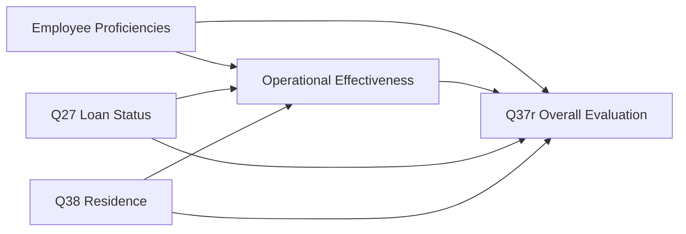

## Purpose and Case Context

This report uses structural equation modeling to examine a theoretically motivated model for Case 31: Employees Federal Credit Union. The model combines two latent constructs with observed single-item variables from the Case 31 data file.

Employee Proficiencies is measured by Q3 through Q6. Operational Effectiveness is measured by Q9r, Q10, Q11, Q12, and Q31 through Q34. The observed variables Q27, current loan status, Q38, headquarters-area residence, and Q37r, overall managerial and operational efficiency, are included as observed variables.

The proposed model examines whether positive evaluations of employee proficiencies are associated with positive evaluations of operational effectiveness and whether operational effectiveness is associated with the overall evaluation Q37r. Because the data are cross-sectional, the paths and indirect effect are interpreted as associations consistent with the model, not proof of temporal causation.

## Learning Notes: Structural Equation Modeling

Structural equation modeling combines a measurement model and a structural model. The measurement model explains how observed indicators measure latent constructs. The structural model explains directional relationships among the latent and observed variables.

In this analysis, the `=~` operator defines the two latent constructs, and the `~` operator defines the structural paths. The `~~` operator is used by `lavaan` to estimate variances and covariances. A latent factor is different from a single-item observed variable because a factor is estimated from several indicators and includes measurement error information.

## Case 31 Hypotheses and Model Rationale

| Research question or hypothesis | Predictor | Outcome | Variable type | Expected relationship | Planned SEM path |
|---|---|---|---|---|---|
| R3 | Employee proficiencies | Operational effectiveness | Latent → latent | Positive association | `Operational_Effectiveness ~ Employee_Proficiencies` |
| R6 | Operational effectiveness | Overall operational efficiency | Latent → observed | Positive association | `Q37_r ~ Operational_Effectiveness` |
| H3 logic | Employee and operational evaluations | Overall operational efficiency | Latent → observed | Positive association | `Q37_r ~ Employee_Proficiencies + Operational_Effectiveness` |
| R4/control | Current loan status and residence | Operational effectiveness and Q37r | Observed controls | Non-directional controls | Paths from `loan_status` and `residence` |

The primary model uses Operational Effectiveness as a latent predictor rather than placing Q31–Q34 both in the factor and separately in the same primary equation. Q31–Q34 were the item-level logic behind H3a–H3d, but using them again as separate predictors would create conceptual overlap with the latent factor.

## Constructs, Indicators, and Variable Roles

| Variable or construct | Role in the model | Indicators or coding |
|---|---|---|
| Employee Proficiencies | Latent predictor | Q3, Q4, Q5, Q6 |
| Operational Effectiveness | Latent mediator/predictor | Q9r, Q10, Q11, Q12, Q31, Q32, Q33, Q34 |
| Current loan status | Observed control | Q27, recoded as `loan_status` |
| Residence | Observed control | Q38, recoded as `residence` |
| Overall operational efficiency | Observed outcome | Q37r, represented as `Q37_r` |

## Data Preparation

```{r}
library(haven)
library(dplyr)
library(tidyr)
library(knitr)
library(lavaan)

case31 <- read_sav("Case 31 Data_efcu_4.sav") |>
  mutate(
    across(
      c(q3, q4, q5, q6, q9_r, q10, q11, q12,
        q27, q31, q32, q33, q34, q38, Q37_r),
      as.numeric
    )
  )

names(case31)
```

The cleaned Case 31 file already contains `q9_r`, the reverse-coded version of Q9. I use this prepared variable rather than reverse-coding Q9 a second time. Q27 and Q38 are categorical variables, so they are recoded into interpretable binary controls for this model.

### Recoding the Observed Controls

```{r}
case31 <- case31 |>
  mutate(
    loan_status = case_when(
      q27 == 1 ~ 1,
      q27 == 2 ~ 0,
      TRUE ~ NA_real_
    ),
    residence = case_when(
      q38 == 1 ~ 1,
      q38 == 2 ~ 0,
      TRUE ~ NA_real_
    )
  )

control_check <- case31 |>
  summarise(
    loan_status_1 = sum(loan_status == 1, na.rm = TRUE),
    loan_status_0 = sum(loan_status == 0, na.rm = TRUE),
    residence_1 = sum(residence == 1, na.rm = TRUE),
    residence_0 = sum(residence == 0, na.rm = TRUE)
  )

kable(control_check, caption = "Counts after recoding Q27 and Q38")
```

The binary coding treats the first response category as 1 and the second response category as 0. This coding is used only to make the regression coefficients easier to interpret. The original variables remain unchanged in the data.

### Missingness and Descriptive Information

```{r}
model_variables <- c(
  "q3", "q4", "q5", "q6", "q9_r", "q10", "q11", "q12",
  "q31", "q32", "q33", "q34", "loan_status", "residence", "Q37_r"
)

missing_table <- case31 |>
  summarise(across(all_of(model_variables), ~ sum(is.na(.x)))) |>
  pivot_longer(
    cols = everything(),
    names_to = "variable",
    values_to = "missing_n"
  )

kable(missing_table, caption = "Missing values for SEM variables")
```

```{r}
descriptive_table <- case31 |>
  summarise(across(
    all_of(model_variables),
    list(
      n = ~ sum(!is.na(.x)),
      mean = ~ mean(.x, na.rm = TRUE),
      sd = ~ sd(.x, na.rm = TRUE)
    )
  )) |>
  pivot_longer(
    cols = everything(),
    names_to = c("variable", ".value"),
    names_sep = "_"
  ) |>
  mutate(across(where(is.numeric), ~ round(.x, 2)))

kable(descriptive_table, caption = "Descriptive information for SEM variables")
```

## Proposed Structural Model

The proposed model has two latent variables and three observed single-item variables. Employee Proficiencies predicts Operational Effectiveness. Operational Effectiveness predicts Q37r, and Employee Proficiencies also has a direct path to Q37r. Q27 and Q38 are included as observed controls for loan status and residence.



The indirect pathway is `Employee Proficiencies → Operational Effectiveness → Q37r`. This pathway is theoretically motivated by the idea that members' perceptions of employees may be related to their broader evaluation of operations, which may then be related to their overall evaluation of managerial and operational efficiency.

## Combined Measurement and Structural Model

```{r}
sem_model <- '
  # Measurement model
  Employee_Proficiencies =~ q3 + q4 + q5 + q6
  Operational_Effectiveness =~ q9_r + q10 + q11 + q12 + q31 + q32 + q33 + q34

  # Structural model
  Operational_Effectiveness ~ a*Employee_Proficiencies + loan_status + residence
  Q37_r ~ b*Operational_Effectiveness + cprime*Employee_Proficiencies + loan_status + residence

  # Indirect and total effects
  indirect := a*b
  total := cprime + (a*b)
'

sem_model
```

Q11 and Q12 are categorical items, so they are declared as ordered variables. The model is estimated using WLSMV, which is appropriate for ordinal indicators in this course analysis. The binary controls are included as observed exogenous variables.

## R/lavaan Analysis

```{r}
ordered_items <- c("q11", "q12")

sem_fit <- sem(
  model = sem_model,
  data = case31,
  estimator = "WLSMV",
  ordered = ordered_items,
  missing = "pairwise"
)

summary(
  sem_fit,
  fit.measures = TRUE,
  standardized = TRUE,
  rsquare = TRUE
)
```

The analysis uses pairwise handling of missing values because WLSMV does not use ordinary maximum-likelihood FIML in the same way as a continuous-data model. The missing-data choice should be considered when evaluating the generalizability of the results.

## Results

### Measurement-Model Review

```{r}
fit_statistics <- fitMeasures(
  sem_fit,
  c("chisq", "df", "pvalue", "cfi", "tli", "rmsea", "rmsea.ci.lower", "rmsea.ci.upper", "srmr")
) |>
  tibble::enframe(name = "measure", value = "value") |>
  mutate(value = round(value, 3))

kable(fit_statistics, caption = "Combined SEM fit statistics")
```

```{r}
loading_results <- parameterEstimates(
  sem_fit,
  standardized = TRUE
) |>
  filter(op == "=~") |>
  transmute(
    factor = lhs,
    indicator = rhs,
    estimate = round(est, 3),
    standardized_loading = round(std.all, 3),
    p_value = round(pvalue, 3)
  )

kable(loading_results, caption = "Standardized factor loadings")
```

The measurement portion should be evaluated before interpreting the structural paths. Stronger standardized loadings indicate that the indicators represent their intended factor more clearly. Weak loadings or poor overall fit would limit confidence in the structural conclusions.

### Structural Paths and Hypothesis Testing

```{r}
structural_results <- parameterEstimates(
  sem_fit,
  standardized = TRUE,
  ci = TRUE
) |>
  filter(op == "~") |>
  transmute(
    outcome = lhs,
    predictor = rhs,
    estimate = round(est, 3),
    standardized_estimate = round(std.all, 3),
    standard_error = round(se, 3),
    p_value = round(pvalue, 3),
    ci_lower = round(ci.lower, 3),
    ci_upper = round(ci.upper, 3)
  )

kable(
  structural_results,
  caption = "Structural regression paths"
)
```

The standardized estimates show the direction and relative size of the relationships. A positive coefficient indicates that higher values of the predictor are associated with higher values of the outcome, holding the other variables constant. A p-value below .05 provides statistical evidence against a zero path in this sample, but it does not establish causality.

### Indirect and Total Effects

```{r}
effect_results <- parameterEstimates(
  sem_fit,
  standardized = TRUE,
  ci = TRUE
) |>
  filter(label %in% c("indirect", "total")) |>
  transmute(
    effect = label,
    estimate = round(est, 3),
    standardized_estimate = round(std.all, 3),
    standard_error = round(se, 3),
    p_value = round(pvalue, 3),
    ci_lower = round(ci.lower, 3),
    ci_upper = round(ci.upper, 3)
  )

kable(effect_results, caption = "Indirect and total effects")
```

The indirect effect estimates the association between Employee Proficiencies and Q37r that operates through Operational Effectiveness. The indirect effect should be interpreted as evidence of an indirect association consistent with the model, not as proof that employee perceptions temporally cause operational evaluations.

### Hypothesis-Testing Summary

```{r}
path_lookup <- structural_results |>
  mutate(
    hypothesis = case_when(
      outcome == "Operational_Effectiveness" & predictor == "Employee_Proficiencies" ~ "R3 / integrated model",
      outcome == "Q37_r" & predictor == "Operational_Effectiveness" ~ "R6 / integrated model",
      outcome == "Q37_r" & predictor == "Employee_Proficiencies" ~ "H3 logic / direct path",
      outcome == "Operational_Effectiveness" & predictor == "loan_status" ~ "Loan-status control",
      outcome == "Operational_Effectiveness" & predictor == "residence" ~ "Residence control",
      outcome == "Q37_r" & predictor == "loan_status" ~ "Loan-status control",
      outcome == "Q37_r" & predictor == "residence" ~ "Residence control",
      TRUE ~ "Other"
    ),
    expected_direction = case_when(
      hypothesis %in% c("R3 / integrated model", "R6 / integrated model", "H3 logic / direct path") ~ "Positive",
      TRUE ~ "Non-directional"
    ),
    decision = case_when(
      expected_direction == "Positive" & standardized_estimate > 0 & p_value < .05 ~ "Supported",
      expected_direction == "Positive" ~ "Not supported",
      TRUE ~ "Control variable"
    )
  ) |>
  select(hypothesis, predictor, outcome, expected_direction,
         standardized_estimate, p_value, ci_lower, ci_upper, decision)

kable(
  path_lookup,
  caption = "Summary of structural paths and hypothesis decisions"
)
```

The table reports the evidence for each structural path. A non-significant path is described as not supported rather than as proof that no relationship exists. Control-variable paths are included to adjust the focal relationships for loan status and residence; they are not treated as primary hypotheses in this integrated model.

## Interpretation, Managerial Meaning, and Limitations

If the path from Employee Proficiencies to Operational Effectiveness is positive, members who evaluate employees more favorably also tend to report more favorable evaluations of operations. If the path from Operational Effectiveness to Q37r is positive, broader operational evaluations are associated with more favorable overall managerial and operational evaluations.

The strongest statistically supported relationships should be considered for managerial interpretation. For example, a meaningful relationship involving employee proficiency may suggest that employee training, service consistency, and member interactions are relevant to members' broader evaluations. These interpretations remain associational because the survey is cross-sectional.

The model also has limitations. Operational Effectiveness combines items with different topics and response formats, and measurement concerns from Assignment 1 can affect the structural paths. Q27 and Q38 are categorical variables recoded as binary controls. Missing-data handling and the single Credit Union case also limit generalizability.

## Conclusion

This SEM combines two latent constructs with observed Case 31 variables and tests a theoretically motivated integrated model. The measurement portion must be considered before interpreting the structural paths. The final conclusions should be based on the reported standardized estimates, confidence intervals, p-values, model fit, and the substantive meaning of the indicators.

The results do not prove that one construct causes another. They show which relationships are consistent with the proposed Case 31 model in this sample and identify which relationships may deserve further investigation with longitudinal or experimental data.

## References

- Case 31: *Employees Federal Credit Union* questionnaire and data-analysis table.
- Rosseel, Y. (2012). lavaan: An R package for structural equation modeling. *Journal of Statistical Software*.
- Course materials on CFA, SEM, and hypothesis testing.

## Appendix: Reproducibility and Publication Links

- [GitHub Repository](https://github.com/jennyjeong53/M15)
- [GitHub Pages](https://jennyjeong53.github.io/M15/)

The final Quarto source file is `case31_m15_sem_hypothesis.qmd`, and the rendered HTML file is `index.html`. The published report and its links were checked before submission.

